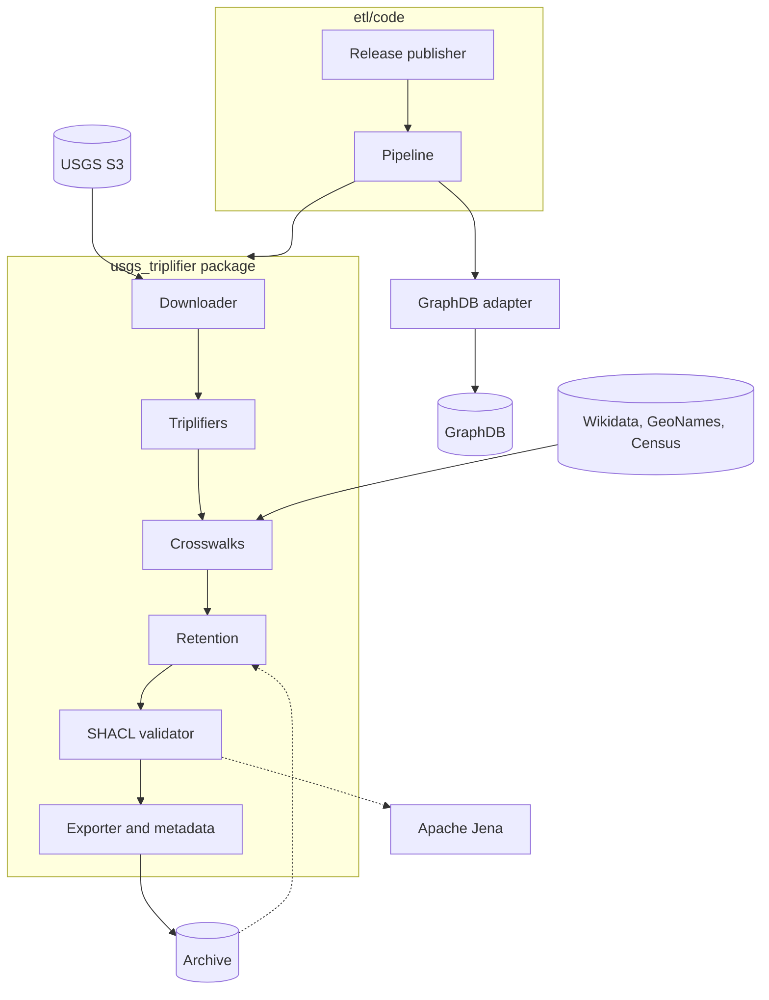
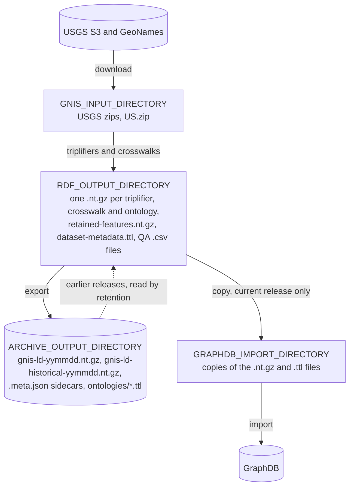

# USGS Triplifier

The ETL process and graph database for gnis-ld.org data

- **Authors**: [Blake Regalia](https://github.com/blake-regalia), Thomas Thelen ([NCEAS](http://www.nceas.ucsb.edu))
- **License**: [Apache 2](http://opensource.org/licenses/Apache-2.0)
- [**Submit Bugs and feature requests**](https://github.com/DataONEorg/usgs-triplifier/issues)
- Contact us: support@dataone.org
- [DataONE discussions](https://github.com/DataONEorg/dataone/discussions)

## Background

The USGS hosts several data products that contain information about places: their location, name(s), descriptions, geometries, etc. These files are hosted by USGS in several formats: text, gdb, and gpkg. This repository contains code to transform a subset of the data into a knolwedge graph and load it into GraphDB.

## Running

The Docker Compose file builds the image and runs GraphDB and the ETL in one container. From the repository root,

```sh
docker compose -f docker/docker-compose.yaml up --build
```

The ETL downloads the USGS products and the crosswalk sources, builds the legacy release and the current release, and loads the current release into GraphDB. A full run takes about an hour, and the ETL can use up to 10 GB of memory, so give Docker at least 12 GB. The GraphDB Workbench is at http://localhost:7200, with the user `admin` and the password `passw0rd` from the Compose file. The release files are written to `/app/data/archive` in the container.

The `usgs_triplifier` package and the ETL code are mounted into the container, so code changes are picked up when the container is restarted. Set `DOWNLOAD_DATA=false` in the Compose file to reuse the files already downloaded into the container, and `PUBLISH_LEGACY_RELEASE=false` to skip the legacy release.

The unit tests run without Docker,

```sh
cd usgs-triplifier
uv sync
uv run pytest
```

To run the full stack on Kubernetes, including a local minikube cluster, use the Helm chart in [gnis-deployment](https://github.com/DataONEorg/gnis-deployment).

## Developing

This section is for codebase reference whether that's for refctoring a triplifier to accomidate a USGS upstream change, tracking down a bug, or figuring out process behavior. 

### Architectrure of a Run



### Downloading Data

The USGS files are downloaded from the public `prd-tnm` USGS S3 bucket into `GNIS_INPUT_DIRECTORY`. The client is anonymous and makes up to 10 attempts per request. If a download fails, the entire run will also fail. A download replaces any previous copies already in the directory. With `DOWNLOAD_DATA=false`, the files already in the directory are read instead.

The text products are pipe-delimited; every attribute is read from them, and the GeoPackage is read only for the multipoint geometries.

The legacy release is built from the 2021-08-25 legacy dump under `Archive/`, which has the same four text products in the format USGS used until 2021. The legacy dump has no GeoPackage. Its fields aren't quoted, while the current products quote fields that contain a double quote or a line break, so the two formats are read with different quoting rules.

### Triplifiers

There's an abstract base class that all the different triplifiers inherit from. If there's a problem in a particular dataset, you might be able to narrow the culprit down by triplifier theme.

### Crosswalks

Crosswalks are done across Wikidata, DBPedia, and Geonames.  Each crosswalk is a subclass of `Crosswalk` in `usgs_triplifier/lib/crosswalk.py`. Its `build` method fetches the other dataset, writes the links as gzipped N-Triples to its own file in `RDF_OUTPUT_DIRECTORY`, and returns the file's path. When the source cannot be reached, `build` writes no file and returns `None`. The pipeline runs every crosswalk, then fails the run if any of them returned `None`, so a release is never published without a crosswalk's links. A new crosswalk is added by subclassing `Crosswalk` and adding the class to `Pipeline.CROSSWALKS`.

| Crosswalk | Source | Links written | Output file |
|---|---|---|---|
| `WikidataCrosswalk` | The Wikidata Query Service | `owl:sameAs` the Wikidata item, the DBpedia resource of its English Wikipedia article and its Who's On First place. `skos:closeMatch` its Library of Congress authority and Getty TGN place. | `crosswalk.nt.gz` |
| `GeoNamesCrosswalk` | The GeoNames US export, `US.zip`, downloaded into `GNIS_INPUT_DIRECTORY` | `owl:sameAs` the GeoNames record | `geonames-crosswalk.nt.gz` |
| `CensusCrosswalk` | The Census Bureau's national gazetteer files for places and counties | `gnis:censusGeoid` and `owl:sameAs` the Data Commons page of the GEOID | `census-crosswalk.nt.gz` |

The Wikidata crosswalk lists every item with a GNIS id (property P590) in one query, then queries the items' links in batches of 10,000, because one query for all of them runs past the endpoint's 60 second limit. Each query is attempted up to 6 times. When a query fails on every attempt, the files written so far are deleted. The GeoNames ids that Wikidata records for the items (P1566) are written to `wikidata-geonames.csv`.

The GeoNames crosswalk pairs features with GeoNames records in `GeoNamesMatcher`. A feature and a record are candidates when they share a normalized name and a state, their feature classes are compatible and they are within the class's distance limit. Each feature is paired with at most one record and each record with at most one feature, and a feature whose best candidate is ambiguous is left unpaired. The pairs are then compared with `wikidata-geonames.csv`, and the disagreements are written to `geonames-qa-disagreements.csv`.

The Census crosswalk reads the gazetteers' ANSI codes, which are GNIS feature ids. Each feature gets at most one GEOID. An independent city, which is in both the place and the county file, gets its county GEOID, and an ANSI code listed twice in one file is skipped.

### Data Management



At the start of the triplify step, the `.nt.gz` and `.ttl` files of the previous run are deleted from `RDF_OUTPUT_DIRECTORY`. The deduplicator rewrites the files there in place. The release files are written to the archive under a `.part` name and renamed after their `.meta.json`, and the historical file is published before the release file, so the website never lists an incomplete release. GraphDB is loaded only for a current release. The legacy release is written to the archive and not loaded.

### Testing with SHACL
Releases are validated against the SHACL shapes with Apache Jena 5, which needs Java 17 or later. The Docker image includes both. To run the ETL or the SHACL tests outside Docker, download a Jena distribution, build the validator into it with `etl/jena/build-validator.sh <Jena directory>`, and set `JENA_HOME` to the Jena directory and `JENA_JAVA_HOME` to the Java runtime. Without them the SHACL tests are skipped.


## Acknowledgments

Work on this package was supported by:

[](http://dataone.org)

NSF OIA grant [2033521](https://www.nsf.gov/awardsearch/showAward?AWD_ID=2033521)